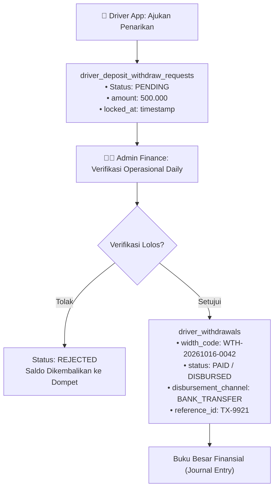

# Knowledge: Financial Ledger & Driver Withdrawal Architecture

> **Enterprise Financial Pattern**: Panduan perancangan sistem penarikan insentif/saldo mitra pengemudi (*driver withdrawal*), pencairan dana, dan buku besar transaksi (*financial ledger*) yang tahan terhadap *race condition* dan *double-spending*.

---

## 1. Masalah Umum di Lingkungan Operasional (Real-World Pitfall)
Pada sistem operasional transportasi dan pengantaran (seperti shuttle atau armada travel):
1. **Kerancuan Antara Permintaan & Realisasi**: Menggabungkan data pengajuan penarikan dana langsung ke dalam satu tabel dengan status pembayaran sering menyebabkan data tidak balance atau insentif supir tertahan saat proses verifikasi admin.
2. **Race Condition Double-Submit**: Supir menekan tombol "Tarik Saldo" berkali-kali secara cepat, memicu request paralel yang mendebit saldo sebelum pengecekan balance selesai.
3. **Ketiadaan Audit Trail Tunggal**: Saat terjadi selisih kas antara finance dan supir, tidak ada kode transaksi unik (*withdrawal code*) yang mengikat antara tiket operasional harian, request saldo, dan bukti transfer perbankan.

---

## 2. Arsitektur Pemisahan Dua Lapisan (*Dual-Table Pattern*)

Gunakan pemisahan ketat antara lapisan **Request** (Permintaan Pengemudi) dan lapisan **Execution / Disbursement** (Pencairan Finansial):



### Tabel 1: `driver_deposite_withdraw_request` (Request Layer)
- Bertanggung jawab mencatat niat penarikan dari mitra.
- Kolom penting: `id`, `driver_id`, `amount`, `bank_code`, `account_number`, `status` (`pending`, `approved`, `rejected`), `requested_at`.
- Saat record dibuat, saldo dompet virtual langsung di-hold (*reserved*) agar tidak dapat ditarik kembali pada request lain.

### Tabel 2: `driver_withdrawals` (Execution & Settlement Layer)
- Bertanggung jawab mencatat realisasi transfer dana keluar dari rekening perusahaan.
- Kolom penting: `id`, `request_id`, `driver_id`, `width_code` (kode unik misal `WTH-YYYYMMDD-XXXX`), `amount`, `admin_fee`, `net_amount`, `paid_at`, `verified_by_user_id`, `proof_document_path`.

---

## 3. Protokol Atomic Locking & Pencegahan Double-Withdrawal

Setiap mutasi saldo wajib dieksekusi di dalam blok transaksi database dengan baris terkunci (*row-level locking*):

```php
// Contoh implementasi pada Laravel Repository / Service:
use Illuminate\Support\Facades\DB;

public function processWithdrawalRequest(int $driverId, float $amount): WithdrawalRequest
{
    return DB::transaction(function () use ($driverId, $amount) {
        // 1. Lock baris dompet driver agar thread paralel menunggu giliran
        $wallet = DriverWallet::where('driver_id', $driverId)->lockForUpdate()->firstOrFail();

        // 2. Validasi saldo aktif setelah di-lock
        if ($wallet->available_balance < $amount) {
            throw new InsufficientBalanceException("Saldo tidak mencukupi untuk penarikan.");
        }

        // 3. Potong available_balance dan pindahkan ke held_balance
        $wallet->available_balance -= $amount;
        $wallet->held_balance += $amount;
        $wallet->save();

        // 4. Buat record request baru
        return DriverDepositWithdrawRequest::create([
            'driver_id' => $driverId,
            'amount' => $amount,
            'status' => 'pending',
            'requested_at' => now(),
        ]);
    });
}
```

---

## 4. Standar Kode Penarikan Unik (`width_code`)
Format kode penarikan wajib menggunakan format terstandarisasi untuk rekonsiliasi manual dan otomatis:
- Format: `WTH-[YYYYMMDD]-[DRIVER_ID]-[SEQUENCE_4_DIGIT]`
- Contoh: `WTH-20261016-104-0012`
- Manfaat: Kode ini tercantum pada mutasi bank perusahaan, slip bukti admin, dan riwayat di aplikasi pengemudi, mengeliminasi sengketa klaim saldo secara tuntas.
