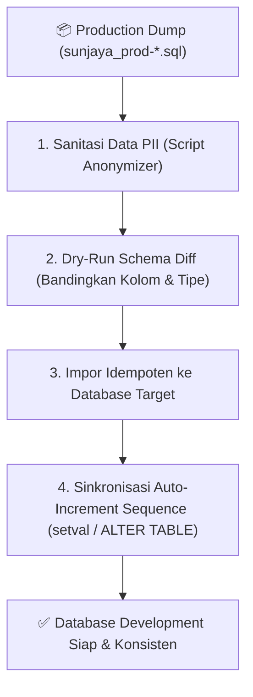

# Knowledge: Production Database Synchronization & Safe Schema Evolution

> **Database DevOps Standard**: Prosedur standar sanitasi, inspeksi, dan sinkronisasi dump basis data produksi (`*.sql`) ke lingkungan pengembangan (*development*) tanpa tabrakan *auto-increment sequence* dan pencegahan *schema drift*.

---

## 1. Risiko Kritis Sinkronisasi SQL Produksi
1. **Auto-Increment Sequence Collision**: Mengimpor data transaksi produksi ke database dev sering kali menyebabkan ID transaksi baru bentrok dengan ID lama jika sequence PostgreSQL (`setval()`) atau auto-increment MySQL tidak disinkronkan ke nilai maksimal (`MAX(id)`).
2. **Schema Drift**: Struktur tabel di database dev memiliki kolom baru yang belum ada di dump produksi, atau sebaliknya, menyebabkan runtime error saat aplikasi mencoba query kolom yang hilang.
3. **Data Sensitif Terpapar di Lingkungan Dev**: Dump produksi sering memuat nomor telepon asli pengguna, password hash, atau token rahasia yang tidak boleh terbaca bebas di log lokal.

---

## 2. Alur 4 Tahap Sinkronisasi Aman



### Tahap 1: Sanitasi Data Pribadi (*Data Masking*)
Sebelum diimpor ke mesin lokal atau dianalisis, lakukan masking data sensitif:
- Email: `user_102@dev-sandbox.local`
- Nomor HP: `0812****0001`
- Kredensial API eksternal: Timpa dengan key testing/sandbox di tabel konfigurasi.

### Tahap 2: Deteksi Schema Drift
Periksa apakah ada kolom di kode aplikasi yang tidak ada di dump SQL produksi:
```sql
-- Contoh kueri verifikasi kolom tabel operasional di MySQL / PostgreSQL:
SELECT column_name, data_type, is_nullable
FROM information_schema.columns
WHERE table_name = 'driver_withdrawals';
```

### Tahap 3: Pemulihan Auto-Increment Sequence (PostgreSQL)
Jika menggunakan PostgreSQL, jalankan skrip perbaikan sequence pada seluruh tabel transaksi:
```sql
-- Reset sequence auto-increment agar sinkron dengan ID tertinggi yang diimpor:
SELECT setval(
  pg_get_serial_sequence('driver_withdrawals', 'id'),
  COALESCE(max(id), 1)
) FROM driver_withdrawals;

SELECT setval(
  pg_get_serial_sequence('driver_deposite_withdraw_requests', 'id'),
  COALESCE(max(id), 1)
) FROM driver_deposite_withdraw_requests;
```

---

## 3. Aturan Emas Migrasi Kolom Produksi (*Backward Compatibility*)
1. **Dilarang Menghapus Kolom Seketika**: Gunakan pendekatan *Expand and Contract*. Tambahkan kolom baru terlebih dahulu, biarkan kode membaca kolom baru atau fallback ke kolom lama, baru hapus kolom lama setelah rilis stabil.
2. **Nullable Sebelum Not Null**: Saat menambahkan kolom baru pada tabel produksi yang sudah memiliki jutaan baris, jadikan kolom tersebut `NULLABLE` terlebih dahulu dengan nilai default, sebelum menambahkan constraint `NOT NULL`.
