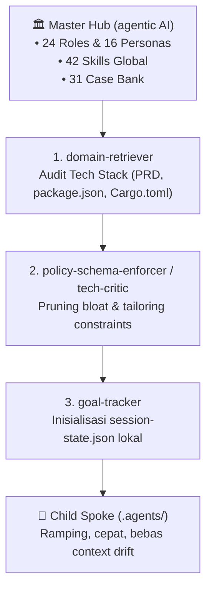

# Knowledge: Child Spoke Adoption & Customization Guide

> **Universal Spoke Provisioning Protocol**: Panduan resmi bagi agen dan pengembang untuk mereview, menyelaraskan, dan mengadopsi tata kelola `.agents` dari **Master Hub** (`agentic AI`) ke dalam repositori proyek anak (*Child Spokes*).

---

## 1. Filosofi & Tiga Peran Penyelaras (*Alignment Roles*)

Ketika sebuah proyek baru mengadopsi Master Hub, sistem tidak menyalin seluruh repositori secara mentah, melainkan diselaraskan oleh kolaborasi 3 peran orkestrasi:



1. **`domain-retriever` (Audit Stack & PRD)**: Membaca kebutuhan proyek dan menentukan arsitektur yang cocok.
2. **`policy-schema-enforcer` / `tech-critic` (Pruning & Tailoring)**: Menghilangkan file yang tidak relevan (*zero bloat*) dan memastikan aturan mutlak keamanan tetap aktif.
3. **`goal-tracker` (State Management)**: Mengunci `established_constraints` awal dan mencatat sub-tugas pertama di `session-state.json`.

---

## 2. Kuesioner Kustomisasi Onboarding (2 Pertanyaan Wajib)

Ketika sebuah proyek mengadopsi `.agents` Master, pengguna disuguhkan 2 pertanyaan kunci untuk menentukan alur kerja dan infrastruktur data:

### Pertanyaan 1: Alur Git & Auto-Push
> *"Untuk development selesai setelah preview, apakah langsung dipush ke GitHub atau tidak?"*

- **Pilihan A: YA (Auto-Push Aktif)**:
  * **Sebelum Development**: Wajib menjalankan `git pull --rebase` untuk mengambil commit terbaru dari rekan tim lain sebelum baris kode pertama ditulis.
  * **Setelah Development & Lolos Preview/QA**: Wajib menjalankan `git pull --rebase` kembali untuk memastikan tidak ada konflik antar-rekan tim saat development berlangsung. Jika bebas konflik atau konflik terpecahkan, baru jalankan `git push`.
  * *Aturan Terkunci*: Terdaftar di `workflows/git-workflow.md` dan `session-state.json` (`C-GIT`).
- **Pilihan B: TIDAK (Manual Push)**:
  * Seluruh commit tersimpan rapi di lokal. Push ke remote dilakukan secara manual atas instruksi pengguna.

---

### Pertanyaan 2: Pilihan Database & Media Storage
> *"Untuk development apakah Anda menggunakan database apa?"*

- **Pilihan A: Supabase**:
  * Mengaktifkan modul otomatis untuk:
    1. **Injeksi Data Idempoten**: Skrip seeding awal menggunakan `upsert` (`ON CONFLICT DO UPDATE`) agar tidak terjadi duplikasi baris data.
    2. **Pembuatan Bucket Storage**: Otomasi penyediaan bucket `public-assets` (gambar katalog publik) dan `private-documents` (dokumen/bukti bayar dengan *signed URL* bertempo).
    3. **Penyimpanan Path**: Database hanya menyimpan path relatif di bucket (misal: `documents/2026/proof-001.jpg`), bukan absolute signed URL yang kedaluwarsa.
- **Pilihan B: PostgreSQL / MySQL Relasional (Laravel / phpMyAdmin / Prisma)**:
  * **Zero-Direct-CRUD ke phpMyAdmin (MUTLAK)**: Agen **DILARANG KERAS** melakukan eksekusi/injeksi CRUD (`INSERT`, `UPDATE`, `DELETE`) atau perubahan skema (`ALTER`, `DROP`, `CREATE`) langsung ke database phpMyAdmin.
  * **Kewajiban Agen**: Agen **CUKUP MEMBUATKAN QUERY SQL TERVERIFIKASI** (dalam blok kode markdown SQL yang bersih atau file skrip `.sql`) agar pengguna sendiri yang memasukkan dan mengeksekusinya di phpMyAdmin.
  * Menerapkan arsitektur 4-layer (Controller -> Service -> Repository -> Model), isolasi soft-delete, transaksi atomik, dan pencegahan N+1 query.
  * File dump skema (seperti `transport_system-*.sql` atau `sunjaya_prod-*.sql`) dijadikan sebagai *knowledge ground-truth*.
- **Pilihan C: SQLite / Local / None**:
  * Menyesuaikan konfigurasi penyimpanan data lokal atau in-memory state.

---

## 3. Empat Alur Operasional Wajib di Setiap Proyek Anak

Setelah kuesioner dijawab, seluruh proyek anak wajib mematuhi 4 alur kerja ini:

### 1. Wajib State `session-state.json` & Case Bank (Tracking Independen dari PRD)
- Setiap pengembangan atau perubahan **wajib** mencatat statusnya di `session-state.json` (sub-tugas, owner role, status `pending` -> `in_progress` -> `done`).
- **PENTING**: Tracking tidak boleh bergantung hanya pada keberadaan `PRD.md` karena banyak proyek nyata tidak memiliki file PRD. `session-state.json` adalah *Single Source of Truth* mandiri yang memungkinkan tim dan agen di sesi percakapan berikutnya langsung melanjutkan pekerjaan tanpa konflik fitur (*feature collision*).

### 2. Wajib Catat Setiap Bug & Ketidaksesuaian ke Case Bank Lokal
- Setiap kali ditemukan bug, error runtime, atau ketidaksesuaian hasil yang berhasil dipecahkan setelah development, agen **wajib** membuat dokumen kasus di `.agents/knowledge/cases/` (format `case-YYYYMMDD-slug.yaml`) sesuai panduan [record-bug-case.md](../workflows/record-bug-case.md).
- Dengan catatan ini, agen AI di masa depan memiliki memori kontekstual dan dijamin tidak akan mengulangi kesalahan yang sama.

### 3. Kepatuhan Standarisasi Arsitektur (Inherited vs Formulated)
- **Jika Proyek Memiliki Standar Eksisting**: Wajib 100% mengikuti pola yang sudah ada (misal: arsitektur 4-layer Controller-Service-Repository pada `adminShuttleV3` dan `admin-sunjaya-dev`). Dilarang keras melakukan perombakan liar di luar kesepakatan tim.
- **Jika Proyek Belum Memiliki Standar**: Agen wajib merumuskan arsitektur standarisasi yang paling cocok:
  * OOP Modular (enkapsulasi domain dan interface).
  * Repository Pattern (isolasi kueri dari presentasi).
  * Clean / Hexagonal Architecture.

### 4. Skill Mapping yang Relevan & Terpasang
- Agen wajib memetakan skill yang relevan dari 42 skill global ke dalam file `AGENTS.md` proyek tersebut (contoh: skill Motion/Tailwind jika UI interaktif, Excel export jika ada modul laporan tabular, Three.js jika 3D, Supabase jika database Supabase).

---

## 4. Otomasi Provisioning via CLI

Master Hub menyediakan skrip otomatis untuk menghasilkan starter pack `.agents` yang sudah disesuaikan:

```bash
# Mode Interaktif (Menjawab 2 Pertanyaan Onboarding Secara Langsung):
npm run spoke:scaffold -- --interactive

# Mode CLI dengan Argumen Lengkap:
npm run spoke:scaffold -- \
  --target "c:\Users\ASUS\Documents\Web Dev\improving\SolanaTradeMemes" \
  --name "SolanaTradeMemes" \
  --type "web3-solana" \
  --git-autopush yes \
  --db supabase \
  --arch clean
```
