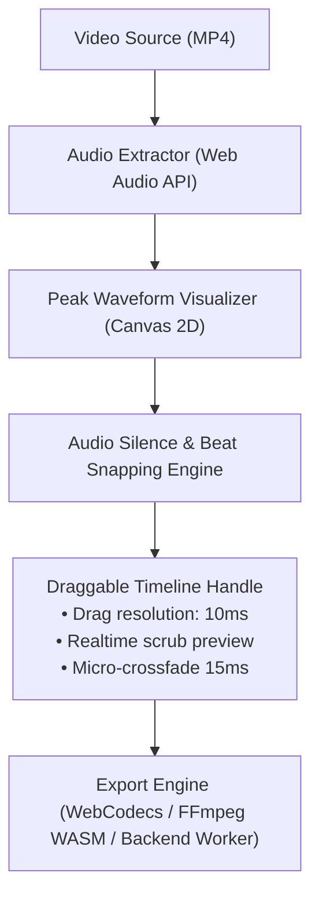

# Knowledge: Video Shorts & Retention Engineering

> **Short-Form Video Automation Standard**: Panduan arsitektur rekayasa video pendek (Shorts, Reels, TikTok) dengan fokus pada metrik retensi penonton 1.000+ views, manipulasi timeline presisi milidetik, dan sinkronisasi audio-visual.

---

## 1. Metrik Kunci Penentu 1.000+ Penayangan Video Pendek

Algoritma platform video vertikal (YouTube Shorts, TikTok, Instagram Reels) menggunakan sinyal retensi murni:

1. **The 3-Second Hook Rule**:
   - 70% penonton memutuskan *swipe away* atau lanjut menonton dalam kurun 0.0 s.d 3.0 detik pertama.
   - Solusi: Klip pembuka wajib langsung memuat gerakan kontras tinggi (*visual punch*), teks pertanyaan menggelitik di area tengah layar (*safe zone*), dan suara punchy tanpa jeda hening (*zero leading silence*).
2. **Completion Rate & Loopability**:
   - Rasio video ditonton sampai selesai (idealnya > 85% untuk video < 30 detik).
   - Kalimat terakhir di akhir video harus menyambung secara alami ke kalimat pertama di awal video (*Seamless Infinite Loop*).
3. **Pacing Dinamis (Visual Cut Pacing)**:
   - Durasi rata-rata per potongan klip (*cut cadence*) adalah antara 1.2 detik hingga 2.8 detik. Pemotongan lebih lambat dari 3.5 detik memicu kebosanan mata penonton.

---

## 2. Mengapa Durasi Pemotongan TIDAK Boleh Fixed (Wajib Milidetik)

Mengunci penambahan/pengurangan durasi pemotongan pada angka statis (seperti selalu 3 detik) adalah *anti-pattern* fatal pada aplikasi video processing:
- **Nafas Dialog Terpotong**: Kata terakhir pembicara sering terpotong di tengah huruf vokal jika durasi dipaksa bulat 3 detik.
- **Audio Popping**: Pemotongan sembarangan tanpa micro-fade di perbatasan klip menghasilkan letupan suara (*clicking noise*).
- **Arsitektur Wajib**: Timeline editor harus mendukung **drag handle fleksibel dengan pembacaan detik dan milidetik (`mm:ss.SSS`)**.

---

## 3. Komponen Arsitektur Timeline Editor Interaktif



### Standar Implementasi State Timeline:
```typescript
interface ClipSegment {
  id: string;
  sourceUrl: string;
  startMs: number;          // Presisi milidetik (contoh: 12450)
  endMs: number;            // Presisi milidetik (contoh: 18120)
  durationMs: number;       // endMs - startMs (contoh: 5670ms)
  volume: number;           // 0.0 s.d 1.0
  fadeInMs: number;         // Micro-fade in (default 15ms)
  fadeOutMs: number;        // Micro-fade out (default 15ms)
  speedMultiplier: number;  // 1.0x, 1.1x, 1.2x
}
```

---

## 4. Safe Zones Layout Vertikal (9:16)
Area tampilan video wajib mematuhi batasan antarmuka bawaan aplikasi media sosial:
- **Header Margin (Top 12%)**: Hindari teks penting di 12% teratas layar (tertutup tombol search dan tab feed).
- **Right Margin (Right 15%)**: Hindari elemen utama di 15% tepi kanan (tertutup tombol like, comment, share, dan profile avatar).
- **Footer Margin (Bottom 20%)**: Hindari teks subtitle di 20% terbawah (tertutup deskripsi video, musik, dan navigation bar).
- **Optimal Text Zone**: Tempatkan teks sorotan (*kinetic subtitles*) di area 30% hingga 60% tinggi layar vertikal.
