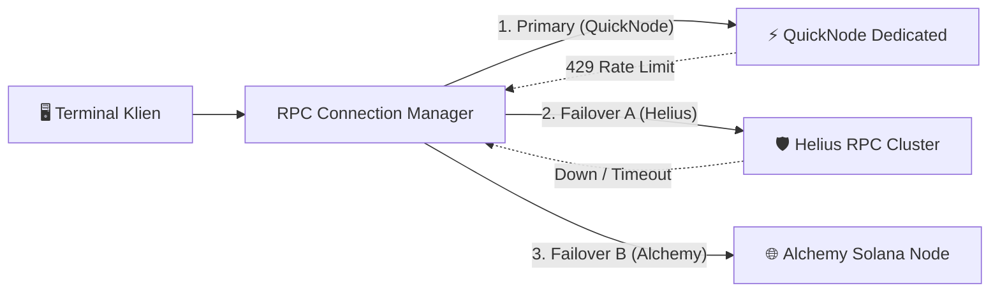

# Knowledge: Web3 Client-Side Architecture & Anti-Hydration Mismatch

> **Web3 Front-End Standard**: Panduan arsitektur *Pure Client-Side Terminal*, integrasi dompet Web3 (Phantom, Solflare, MetaMask), dan resolusi permanen *React SSR/CSR Hydration Mismatch* pada framework Next.js.

---

## 1. Tantangan Utama: React SSR Hydration Mismatch di Web3

Ketika mengembangkan aplikasi Web3 menggunakan Next.js (App Router maupun Pages Router), error konsol yang sangat umum terjadi adalah:
```text
Error: Text content does not match server-rendered HTML.
Warning: A tree hydrated but some attributes of the server rendered HTML didn't match the client.
```

### Akar Masalah:
- Di sisi server (SSR), objek browser seperti `window`, `localStorage`, atau `window.solana` (Phantom wallet adapter) **belum ada** (*undefined*).
- Komponen merender status seperti *"Connect Wallet"* di server.
- Namun begitu halaman tiba di peramban pengguna (CSR), extension Phantom langsung menginjeksi akun dan alamat dompet (misal: `"7Xo9...4bQ2"`), sehingga markup HTML klien berbeda dari HTML yang dikirim server.

---

## 2. Pola Solusi Baku: Two-Pass Mounting Guard

Untuk mengeliminasi error ini secara deterministik tanpa menonaktifkan SSR untuk seluruh aplikasi:

```tsx
// hooks/useIsMounted.ts
import { useEffect, useState } from 'react';

export function useIsMounted() {
  const [mounted, setMounted] = useState(false);
  useEffect(() => {
    setMounted(true);
  }, []);
  return mounted;
}
```

```tsx
// components/web3/WalletButton.tsx
'use client';

import React from 'react';
import { useWallet } from '@solana/wallet-adapter-react';
import { useIsMounted } from '@/hooks/useIsMounted';

export function WalletButton() {
  const isMounted = useIsMounted();
  const { connected, publicKey, connect, disconnect } = useWallet();

  // Guard: Selama fase SSR, render skeleton placeholder identik
  if (!isMounted) {
    return (
      <button 
        disabled 
        className="px-4 py-2 bg-zinc-800 text-zinc-400 rounded-lg animate-pulse"
      >
        Initializing Wallet...
      </button>
    );
  }

  return (
    <button
      onClick={connected ? disconnect : connect}
      className="px-4 py-2 bg-violet-600 hover:bg-violet-500 text-white font-medium rounded-lg transition"
    >
      {connected && publicKey 
        ? `${publicKey.toBase58().slice(0, 4)}...${publicKey.toBase58().slice(-4)}`
        : 'Connect Phantom'}
    </button>
  );
}
```

Atau menggunakan **Dynamic Import dengan `ssr: false`**:
```tsx
import dynamic from 'next/dynamic';

export const DynamicTerminalTradingView = dynamic(
  () => import('@/components/trading/TradingTerminalView'),
  { ssr: false, loading: () => <TerminalLoadingSkeleton /> }
);
```

---

## 3. Resilient RPC Pool Architecture (Rate-Limit Protection)

Penyedia RPC publik sering terkena pembatasan *HTTP 429 Too Many Requests*. Bangun koneksi dengan failover cluster:



1. **Jittered Exponential Backoff**: Ulangi transaksi yang gagal dengan penundaan acak (misal $100ms \times 2^n \pm \text{random}(50ms)$) agar tidak membanjiri RPC secara serentak.
2. **Transaction Simulation**: Wajib panggil `connection.simulateTransaction(tx)` sebelum memanggil `sendRawTransaction` untuk menampilkan perkiraan gas fee, slippage, dan status akun yang akurat kepada pengguna.
