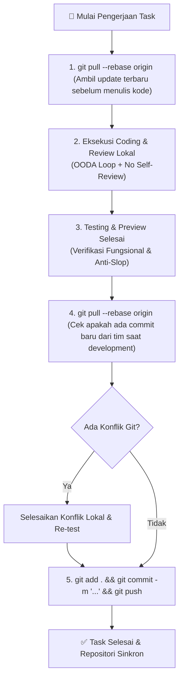

# Workflow: Git Synchronization Protocol (Pull-Before-Build & Pull-Before-Push)

> **Mandatory Git Discipline**: Alur sinkronisasi Git untuk proyek yang mengaktifkan auto-push ke GitHub guna mencegah *merge conflicts*, kehilangan commit tim lain, dan memastikan kode yang terdorong ke repositori adalah kode yang bersih dan teruji.

---

## 1. Alur Sinkronisasi Git Dua Fase



---

## 2. Langkah-demi-Langkah Eksekusi

### Fase A: Sebelum Development (Pre-Build)
1. Periksa status cabang kerja lokal:
   ```bash
   git status
   ```
2. Tarik perubahan terbaru dari remote sebelum mengubah baris kode apa pun:
   ```bash
   git pull --rebase origin <current-branch>
   ```
   *Alasan*: Mencegah Anda membangun fitur di atas basis kode usang yang sudah diubah oleh rekan tim lain.

---

### Fase B: Setelah Development & Preview Lolos (Post-Verification)
1. Pastikan seluruh pengujian (preview lokal, unit test, build test) telah lolos:
   - Preview visual sesuai ekspektasi.
   - Tidak ada error di konsol terminal atau browser.
   - Reviewer (`qa-engineer` atau `tech-critic`) telah memberikan status `approved`.
2. Tarik kembali perubahan terbaru dari remote sebelum melakukan push:
   ```bash
   git pull --rebase origin <current-branch>
   ```
3. Jika terdapat konflik:
   - Selesaikan konflik file dengan hati-hati.
   - Jalankan ulang preview untuk memastikan perbaikan konflik tidak merusak fitur yang baru dibuat.
4. Lakukan commit terstruktur dan push ke GitHub:
   ```bash
   git add .
   git commit -m "feat(scope): deskripsi perubahan fitur yang jelas"
   git push origin <current-branch>
   ```

---

## 3. Aturan Pencegahan Konflik
- **Dilarang Force Push**: Dilarang menggunakan `git push --force` di cabang utama (`main`/`master`) tanpa persetujuan eksplisit pemilik proyek.
- **Commit Atomik**: Setiap commit harus memuat satu kesatuan perubahan yang utuh dan dapat berfungsi (*functional atomic commit*).
