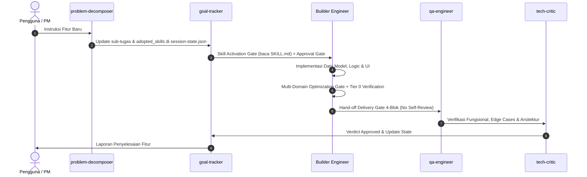

# Workflow: New Feature Lifecycle (Universal Spoke SOP)

> **Standard Operating Procedure**: Alur standar pengembangan fitur di proyek anak (*Child Spoke*) mulai dari Planning, Skill Activation, Development, Optimization, Evaluasi QA, hingga serah terima produksi.

---

## Alur Pengembangan Terstruktur

---

## Langkah-demi-Langkah

1. **Langkah 1: Planning, Dekomposisi & Skill Activation Gate**:
   - `problem-decomposer` memecah kebutuhan menjadi sub-tugas independen dan menyusun Review Gate sesuai [`workflows/task-review-protocol.md`](./task-review-protocol.md).
   - **Skill Activation Gate (Wajib)**: Periksa `adopted_skills` di `session-state.json` (dan katalog 60 skill global jika perlu). Deklarasikan skill aktif untuk tugas ini, **baca `SKILL.md`-nya sebelum menulis baris kode pertama**, lalu catat di `skill_activation_log`.
   - Tunggu persetujuan pengguna (*Human-in-the-Loop Approval Gate*) sebelum menulis kode.

2. **Langkah 2: Definisi Kontrak, Skema Data & Visual Anchor**:
   - Definisikan kontrak tipe/API/skema terlebih dahulu.
   - Jika melibatkan antarmuka UI, patuhi [`rules/32-visual-first-engineering.md`](../rules/32-visual-first-engineering.md) (ASCII Wireframe, Visual Anchor di `scratch/ui-references/`, tanpa slicing `
` mentah).

3. **Langkah 3: Implementasi Terarah (Backend / Frontend / Domain Engine)**:
   - Terapkan guard clauses, result pattern, isolasi arsitektur sesuai standar proyek, komentar kode bersih bebas jargon AI, serta eliminasi dead/zombie code.
   - Hormati *Co-Developer Non-Regression Guard* (`git diff`/`git blame`).

4. **Langkah 4: Multi-Domain Optimization Gate (Sebelum QA)**:
   Lakukan pengecekan optimasi sesuai stack proyek:
   - **Database / Backend**: cegah N+1 query, gunakan indeks / Database View / Stored Procedure bila perlu, transaksi atomik, dan streaming export anti-OOM.
   - **Frontend / UI**: hindari re-render tak perlu, lazy-load aset berat, cek responsive reflow 390px, kontras WCAG AA, dan navigasi keyboard.
   - **3D WebGL / Diorama**: batasi `devicePixelRatio <= 2.0`, jaga anggaran draw calls, wajib panggil `.dispose()` saat swap geometry/material/texture, dan pastikan animasi deterministik `f(t)`.
   - **Video & Motion**: jaga budget `ms/frame`, pekerja render paralel, sinkronisasi audio-visual (micro-crossfade 15ms pada sambungan klip), dan inspeksi contact sheet sebelum final encode.
   - **Context & Token**: pangkas file scratch sementara dan jaga `session-state.json` tetap ringkas.

5. **Langkah 5: Mandatory Delivery Gate 4-Blok & Evaluasi Independen (*No Self-Review*)**:
   - **Verifikasi Tier 0 (Wajib Otomatis)**: jalankan lint/typecheck/build (`npm run build`, `tsc --noEmit`, `node --check`, `py_compile`, atau `php -l`) serta cek **Mandatory Delivery Gate 4-Blok** (`antislop`: Hard Gate 0 em dash & data riil, Purpose-Gate, Liveliness, Craftsmanship).
   - **Verifikasi Tier 1 & Tier 2 (Mengikuti [`workflows/post-dev-qa.md`](./post-dev-qa.md))**: jalankan runner otomatis / Playwright / QA harness domain sesuai kebijakan `qa_policy` (on-demand untuk edit rutin; wajib ditawarkan dengan rencana singkat pada rilis UI/3D/Video baru).
   - `qa-engineer` dan `tech-critic` memberikan vonis kelolosan independen.

6. **Langkah 6: Penyelesaian, Pemutakhiran State & Case-Bank**:
   - `goal-tracker` menandai sub-tugas `done` di `session-state.json`.
   - Jika ditemukan bug/pola penting selama pengerjaan, catat ke `.agents/knowledge/cases/` sesuai [`workflows/record-bug-case.md`](./record-bug-case.md).
