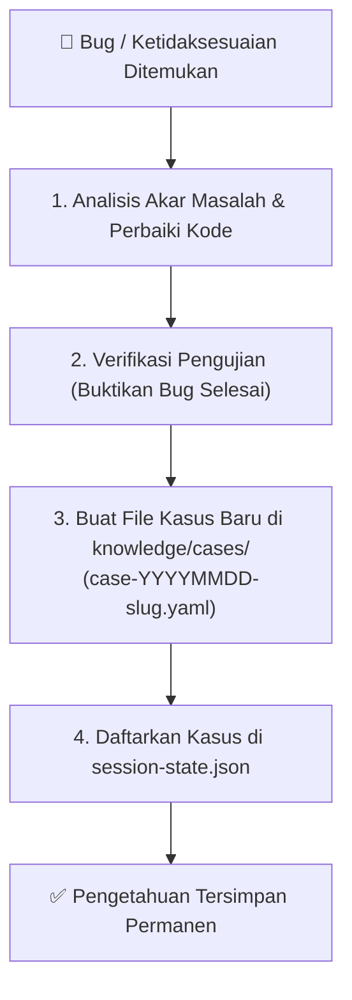

# Workflow: Mandatory Bug & Discrepancy Case Logging

> **Continuous Organizational Learning**: Setiap kali terjadi bug, kesalahan logika, error runtime, atau ketidaksesuaian hasil setelah proses development, agen dan pengembang **WAJIB** mencatat kasus tersebut ke bank kasus lokal (`knowledge/cases/`).

---

## 1. Mengapa Setiap Bug Harus Dicatat?
1. **Mencegah Bug Berulang**: Agen AI di sesi percakapan berikutnya akan membaca folder kasus dan tidak akan mengulangi kesalahan yang sama.
2. **Konteks Historis Tim**: Rekan tim lain dapat mengetahui akar penyebab teknis tanpa harus menganalisis ulang dari awal (*root-cause history*).
3. **Upstream Learning**: Kasus dengan nilai guna umum dapat dipromosikan ke Master Hub (`agentic AI`) untuk memperkaya seluruh ekosistem proyek.

---

## 2. Alur Pencatatan Kasus Bug



---

## 3. Format Penamaan & Struktur Berkas Kasus
- Lokasi: `.agents/knowledge/cases/case-[YYYYMMDD]-[slug-deskripsi-singkat].yaml`
- Contoh: `case-20261017-auth-token-cookie-mismatch.yaml`

Format konten mengikuti template baku:
```yaml
id: "case-20261017-auth-token-cookie-mismatch"
title: "Resolusi Token Cookie Kadaluarsa saat Fetching API Operasional"
date: "2026-10-17"
severity: "HIGH | MEDIUM | LOW"
affected_component: "app/Http/Middleware/VerifyAuthToken.php"
status: "VERIFIED"
summary: "Penjelasan ringkas 1-2 kalimat mengenai masalah dan perbaikan yang dilakukan."

problem:
  symptom: "Pengguna terlempar ke halaman login saat membuka menu settlement."
  root_cause: "Token refresh tidak memperbarui header cookie pada request background."

solution:
  description: "Perbaikan alur refresh token dengan mekanisme auto-retry ber-jitter."
  key_changes:
    - "Pembaruan middleware auth untuk membaca fallback cookie."
    - "Pembersihan session storage lama sebelum regenerasi token."

verification:
  test_performed: "Simulasi token expired di Playwright test; sesi berhasil diperpanjang otomatis tanpa reload paksa."
  reviewed_by:
    - role: "qa-engineer"
      verdict: "approved"
    - role: "tech-critic"
      verdict: "approved"
```
